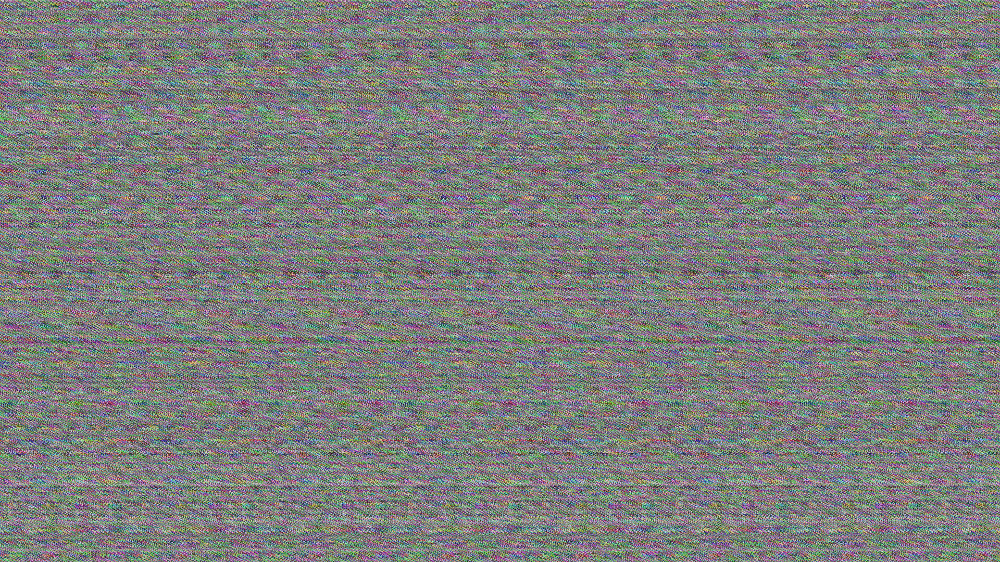
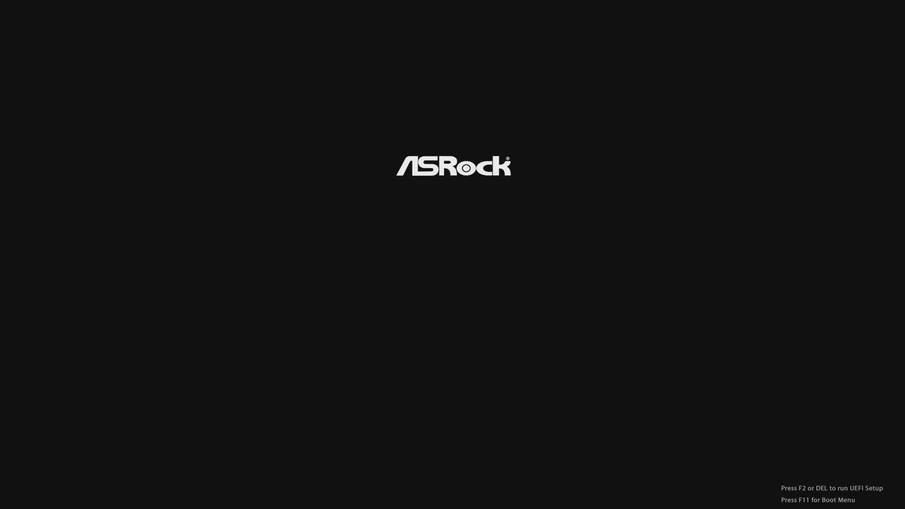
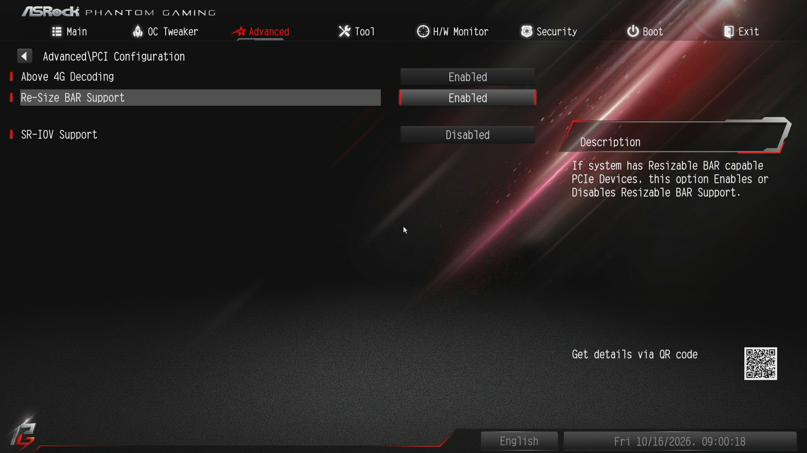

# ASRock X570S PG Riptide: no POST picture with a GPU in the chipset slot and Above 4G Decoding on

**TL;DR** If your GPU sits in a chipset-connected x16 slot on an AM4 board and the screen shows
noise (or nothing) from power-on until the boot loader, try **Above 4G Decoding = Disabled**. On
this board the firmware places the GPU's memory window above 4 GiB but does not program the
upstream PCIe bridges for it, so the POST screen never reaches the card.

Status: reported to ASRock through their support form on 2026-10-16 (no ticket number yet).
No fix as of BIOS P5.82. Discussion:
[Level1Techs thread](https://forum.level1techs.com/t/asrock-x570s-pg-riptide-no-post-picture-noise-with-a-gpu-in-the-chipset-slot-and-above-4g-on-cause-and-workaround/258816).

## Setup

- ASRock X570S PG Riptide, BIOS **P5.80** and **P5.82** (beta, AGESA ComboAM4v2 1.2.0.12)
- AMD Ryzen 5 5600 (no integrated graphics)
- Intel Arc A310 in the **lower x16 slot** (4 lanes from the X570 chipset)
- Upper x16 slot: 4x NVMe adapter, `PCIe x16 Switch = 4X4`
- Also behind the chipset: Intel X550-T2 NIC, JMB58x SATA controller
- CSM disabled, UEFI boot, Linux host (Proxmox VE)

## Symptom

From power-on until the operating system's boot loader the monitor receives a valid 1920x1080
signal full of random noise. No POST logo, no UEFI setup, no F11 boot menu, although the keyboard
works in all of them. The same happens with an NVIDIA card in that slot, on several monitors and
on a PiKVM capture. A card in the upper (CPU) slot displays normally. The same configuration worked
on an older BIOS about a year ago.

| Above 4G on | Above 4G off |
|---|---|
|  |  |

## What fixes it

`Advanced > PCI Configuration > Above 4G Decoding = Disabled`.

Re-Size BAR alone makes no difference: with Re-Size BAR off and Above 4G on, the (then 256 MB)
BAR still goes above 4 GiB and POST is still noise. Re-Size BAR is greyed out while Above 4G is off.

Both options are **Enabled by factory default**, so a BIOS flash or a CMOS clear brings the
problem back.



## Why

The Linux kernel's first PCI enumeration lines show the bridge windows exactly as the firmware
left them. With Above 4G on:

```
00:01.2 (CPU root port, chipset uplink)  pref window 0xfc400000-0xfccfffff
01:00.0 (chipset upstream port)          pref window 0xfc400000-0xfccfffff
02:01.0 (chipset downstream port)        pref window 0x7e00000000-0x7f007fffff
04:00.0 / 05:01.0 (Arc internal switch)  pref window 0x7e00000000-0x7effffffff
06:00.0 Arc A310, BAR 2                  0x7e00000000-0x7effffffff (4 GB)
```

The lower half of the chain is programmed for the BAR above 4 GiB; the CPU root port and the
chipset upstream port are not. The firmware's POST screen writes into the framebuffer, the root
port does not forward that address, and the card scans out whatever is in its VRAM. Linux logs
`can't claim; no compatible bridge window`, reassigns the whole chain, and works from there, so the
OS never notices. With Above 4G off the whole chain is placed at `0xd0000000` and POST is correct.
In the upper slot the GPU sits directly on a CPU root port, so there is only one bridge to get right.

Full excerpt for all three states: [kernel-log-excerpt.txt](kernel-log-excerpt.txt).

Check your own board on Linux:

```sh
dmesg | grep -E "bridge window|BAR 2|can't claim"
```

`can't claim` on your GPU's path at boot is the same signature.

## Ruled out / observed

- **Monitor or capture device**: a valid signal carrying noise means the card is scanning out
  unwritten memory.
- **Settings drift between BIOS versions**: ten images (2.20 to 5.82) unpacked with UEFIExtract and
  IFRExtractor-RS. The defaults for Above 4G Decoding and Re-Size BAR are Enabled in all of them,
  byte-identical in the NVRAM defaults store (`PCI_COMMON` = `00 00 01 01 01`).
- **What did change**: AMD's PCIe init modules (`AmdNbioPcieDxe`, `AmdNbioPcieZPDxe`) in P5.65
  (AGESA 1.2.0.E) and again in P5.82; AMI's `PciBus` / `PciRootBridge` last changed in P5.50 and
  P5.82. **P5.82 does not fix it.** Which version introduced the fault is unconfirmed.

## Cost of the workaround

With a 256 MB BAR instead of 4 GB, on this machine:

| Test (Arc A310) | Above 4G + ReBAR off | on |
|---|---|---|
| 4K HEVC -> 1080p H.264 transcode, 600 frames, all on GPU | 1.81 s | 1.78 s |
| 4K HEVC GPU decode + download every frame to RAM | 4.26 s | 4.23 s |
| Whisper large-v3-turbo on the GPU, 5 s / 30 s clip | 0.44 / 0.48 s | 0.44 / 0.48 s |

About 1.6% on transcodes, nothing on inference. For a media or AI server that is noise; for
gaming it may matter more.

## Same problem on your board?

Open an issue here with the board, BIOS/AGESA version, the slot, and whether Above 4G off fixes it.
More reports make it easier for the vendors to act.
